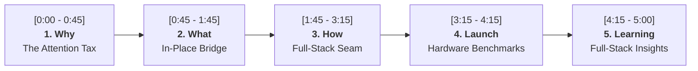
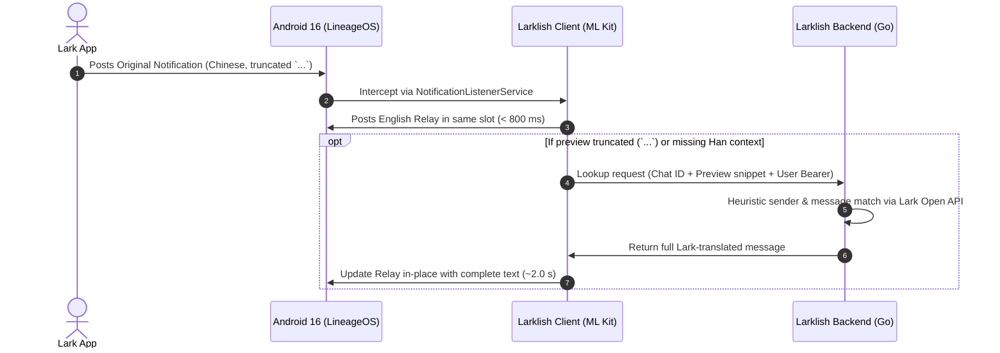
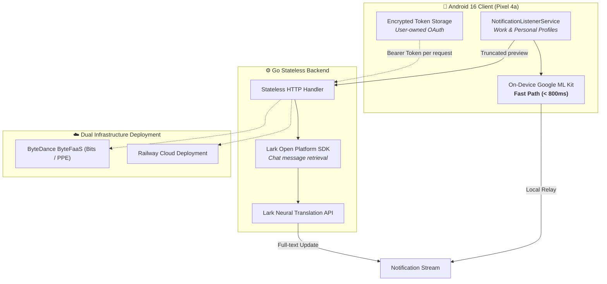

# 🎙️ Larklish: Read the Full Lark Notification Before You Open the App

**GEC-B AI Fullstack Demo Day · Speaker #10**  
**Presenter:** Max Coplan · [Hackathon Submission](https://bytedance.us.larkoffice.com/docx/BuiYd05cvoXy4Vxp267uKodKsWg) · [Repository](https://code.byted.org/max.coplan/larklish)  
**Target Duration:** 5:00 Minutes (300 Seconds)

---

## ⏱️ Pacing & Timeline Roadmap

| Time Milestone | Section | Key Visual | Core Takeaway |
| :--- | :--- | :--- | :--- |
| **0:00 – 0:45** (45s) | **1. Why** | Attention Barrier Visual | Every truncated notification is an attention tax |
| **0:45 – 1:45** (60s) | **2. What** | 10-Second Lifecycle Flow | In-place replacement: Original → Relay → Update |
| **1:45 – 3:15** (90s) | **3. How** | System Architecture | Pragmatic AI: AI for translation, code for routing |
| **3:15 – 4:15** (60s) | **4. Launch** | Benchmark Metrics Cards | 768ms first relay; 1,905ms full-text recovery |
| **4:15 – 5:00** (45s) | **5. Learning**| Seam Engineering Quote | Meet users at OS seams, not inside another app |

---

## 1. Why: The Attention Tax (0:00 – 0:45)

* **The Problem:** Globally distributed teams communicate across languages. But every notification comes with friction:
  - **Truncation:** Lark cuts off long messages with an ellipsis (`...`). You must unlock, open Lark, hunt down the chat, and translate it—often for an operational update.
  - **Siri Failure:** Hands-free voice (driving, walking, cooking) fails completely with *"I cannot read this message."*
  - **The Attention Tax:** Senders are pressured to write in a second language, or recipients suffer constant context switching.

> 🗣️ **What to say:**  
> *"Hi everyone, I’m Max, and today I’m sharing **Larklish**.*  
>  
> *We work on a fast-moving, globally distributed team where discussions, on-call alerts, and release notices happen in Chinese. But for non-native speakers, every notification comes with two daily frustrations:*  
>  
> *First, when your hands are full walking or driving, Siri literally gives up and says: ‘I cannot read this message.’*  
> *Second, Lark constantly cuts off long messages with an ellipsis (`...`). To see what was actually said, you have to unlock your phone, open Lark, hunt down the chat, and translate it—only to realize it was just an operational update.*  
>  
> *Every notification becomes an **attention tax**. We asked: Why force senders to write in a second language, or force recipients into constant context switching? What if the notification itself solved the problem?"*

---

## 2. What: The In-Place Notification Bridge (0:45 – 1:45)

### The 10-Second Lifecycle

* **In-Place Replacement:** Replaces the notification in the exact same slot; zero clutter.
* **Preserves Actionability:** Sender avatar, group tag, and original tap target remain intact.
* **Zero Workflow Disruption:** Senders write in Chinese; recipients triage in English.

> 🗣️ **What to say:**  
> *"Here is **Larklish**: a full-stack, AI-powered notification bridge.*  
>  
> *It doesn’t ask our team to change how they communicate. Senders write naturally in Chinese; recipients get actionable English notifications directly in their stream.*  
>  
> *Here’s the experience:*  
> *When an Original Lark notification arrives, Larklish intercepts it and immediately posts an English **Relay** in the exact same notification slot, preserving the sender identity and the tap target to open the chat.*  
>  
> *If the preview was complete, you’re done. But if Lark cut the message short with `...`, Larklish calls our Go backend to run a targeted **Lookup** via Lark Open APIs, fetches the full un-truncated text, translates it, and seamlessly **Updates** that same notification in place.*  
>  
> *You triage in seconds right from your lock screen, and Siri reads it hands-free. You only open Lark when a message truly demands deeper action."*

---

## 3. How: Pragmatic Full-Stack Architecture (1:45 – 3:15)

### Architecture Principles

1. **Smart Two-Tier Fallback:**
   - **Fast Tier (Local on Phone):** On-device Google ML Kit produces a gist translation in under 800ms. Offline-safe.
   - **Deep Tier (Cloud Backend):** Resolves full-text truncated messages via Lark Open Platform API and neural translation in ~2.0s.
2. **Pragmatic AI Division:**
   - **AI handles language:** Neural translation and semantic nuance.
   - **Deterministic code handles systems:** Notification slots, sender extraction, regex identification, and token rotation.
3. **Stateless Privacy:**
   - The phone holds the rotating OAuth token; the backend never stores credentials, tokens, or message bodies.

> 🗣️ **What to say:**  
> *"Building this required solving a real systems problem at the seam between the Android OS and Lark.*  
>  
> *On the **Frontend**, we built a native Android notification listener running on Android 16. It runs on-device Google ML Kit to deliver an instant local translation in under 800 milliseconds. If the network drops or the backend fails, that local Relay guarantees you never lose context.*  
>  
> *On the **Backend**, we engineered a lightweight Go service deployed on **ByteDance ByteFaaS** and **Railway**. When a preview is cut off, the backend takes the chat metadata, queries Lark's API, heuristically matches the message, fetches the complete text, and translates it.*  
>  
> *Our core design philosophy was **Pragmatic AI**: We use AI strictly for translation. Everything else—notification lifecycle parsing, sender matching, OAuth token rotation, and message selection—is deterministic, robust code. The backend is completely stateless and stores zero messages or credentials."*

---

## 4. Launch: Real-World Hardware Benchmarks (3:15 – 4:15)

### Measured Production Latencies (Pixel 4a)

| Metric | Target SLA | Measured Median | Empirical Validation |
| :--- | :--- | :--- | :--- |
| **First English Relay (Local ML Kit)** | < 1,000 ms | **768 ms** | Sub-second lock-screen triage |
| **End-to-End Truncated Recovery** | < 3,000 ms | **1,905 ms** | Real long-message incident run |
| **Full-Text In-Place Update** | < 2,500 ms | **2.07 s** | Lark API + Neural translation round-trip |
| **Replay Corpus Test Suite** | 100% Pass | **165 Scenarios** | Validates group, DM, and bot matching |

* **Code Fidelity:** Variable names, merge request identifiers, and `@mentions` remain intact without translation corruption.
* **Dual Profile Support:** Handles both Work and Personal profiles simultaneously on modern Android.

> 🗣️ **What to say:**  
> *"We didn’t just build a prototype; we benchmarked every layer on real hardware.*  
>  
> *In our instrumented tests on a Pixel 4a:*  
> - *Our median time to post the first English Relay is just **768 milliseconds**.*  
> - *For long truncated messages, the full round-trip—detecting truncation, querying Lark APIs, translating hundreds of characters, and updating the notification card—has a median latency of **2.07 seconds**.*  
>  
> *To guarantee reliability, we built a 165-message replay corpus test suite to prevent message-matching regressions across group chats, direct messages, and bot pings.*  
>  
> *It works seamlessly in the background, preserving code identifiers, variable names, and PR links."*

---

## 5. Learning: Full-Stack Takeaways (4:15 – 5:00)

> ### *"Larklish does not ask the team to communicate differently. It makes the communication we already have immediately usable."*

1. **Engineering the Seam:**  
   Most AI productivity tools create another web dashboard or chat window. Real leverage comes from embedding AI silently at existing OS seams—where users make split-second decisions.
2. **Two-Tier Graceful Degradation:**  
   Pairing ultra-fast on-device ML Kit with deep cloud APIs gives users sub-second speed without sacrificing full-text depth.
3. **Evidence-Driven Design:**  
   Through deletion experiments, we proved mathematically that both local ML Kit and cloud Lookup justified their existence before keeping them in the stack.

> 🗣️ **What to say:**  
> *"Reflecting on this full-stack AI journey, our biggest takeaways were:*  
>  
> 1. ***Engineering the Seam:*** *Most AI tools create another web dashboard or chat window. Real leverage comes from embedding AI silently at existing OS seams—where users make split-second decisions.*  
> 2. ***Two-Tier Graceful Degradation:*** *Pairing ultra-fast on-device ML Kit with deep cloud APIs gives users sub-second speed without sacrificing full-text depth.*  
>  
> *To close: **Larklish does not ask the team to communicate differently. It makes the communication we already have immediately usable.***  
>  
> *Thank you! I'm happy to take any questions."*

---

## 🛡️ Q&A Defense Quick Hits

* **Q: How is security & privacy handled?**  
  **A:** *"The phone owns the rotating OAuth refresh token in encrypted storage. The Go backend is strictly stateless—it handles the request in memory and never logs or stores message text or user tokens."*
* **Q: Why not just use Lark's built-in translation?**  
  **A:** *"Lark translation requires you to stop, unlock, tap, and open the chat. Larklish operates before you open the app, enabling instant lock-screen triage and hands-free voice readouts via Siri."*
* **Q: What if multiple messages arrive in a noisy group at the same time?**  
  **A:** *"The backend fetches the recent message batch and matches both sender and visible text prefixes. If there's any ambiguity, it safely preserves the local on-device translation without risking an incorrect update."*
