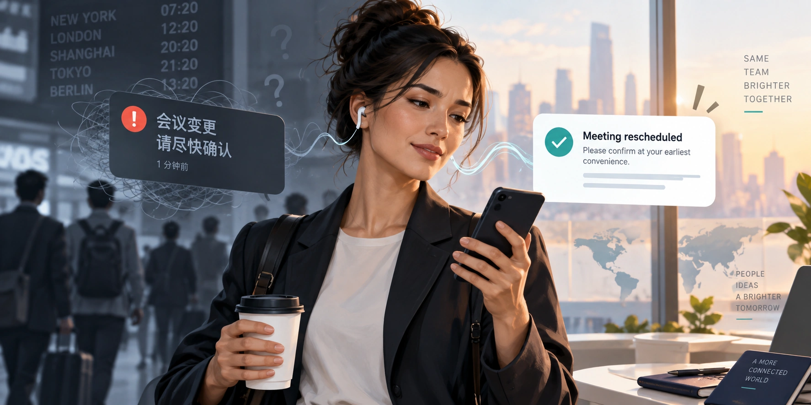
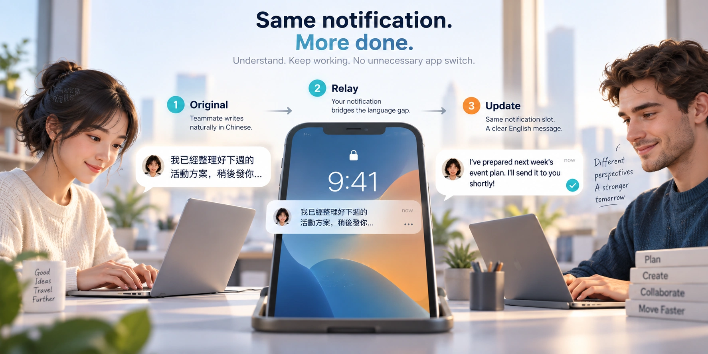
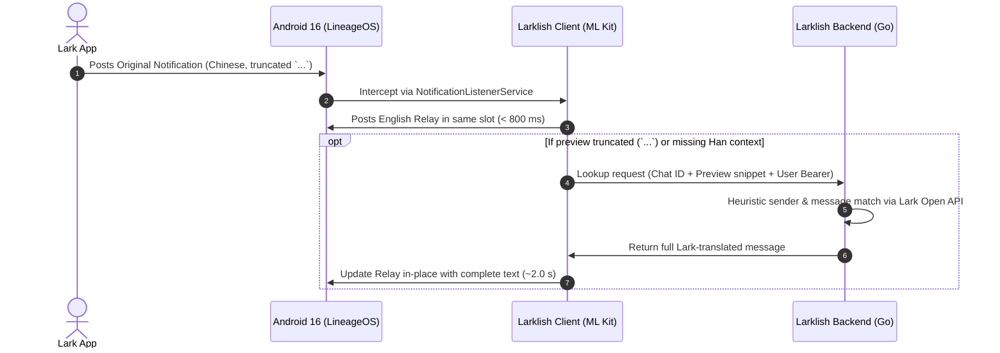
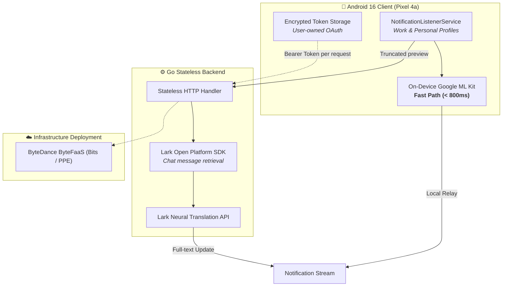
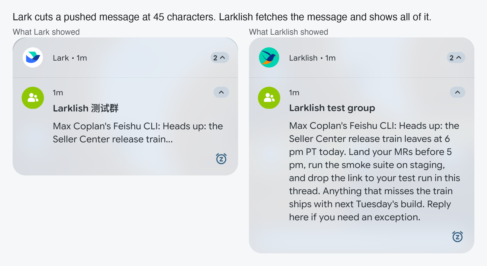
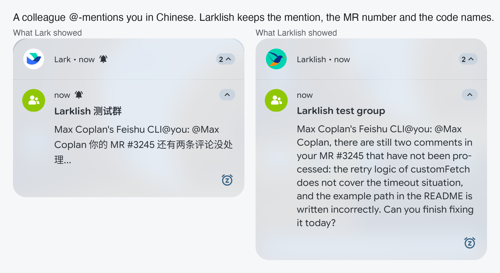

# 🎙️ Larklish: Read the Full Lark Notification Before You Open the App

**GEC-B AI Fullstack Demo Day**  
**Author:** Max Coplan · [Hackathon Submission](https://bytedance.us.larkoffice.com/docx/BuiYd05cvoXy4Vxp267uKodKsWg) · [Repository](https://code.byted.org/max.coplan/larklish)

---

## 1. The Problem: The Attention Tax

* **The Reality of Global Collaboration:** Discussions, on-call alerts, and release notices frequently happen in Chinese across distributed engineering teams.
* **The Notification Dilemma:**
  - **Truncation:** Lark frequently cuts off long messages with an ellipsis (`...`). Determining the actual content requires stopping, unlocking, opening Lark, locating the chat, and translating—often just for a routine operational update.
  - **Hands-Free Audio Breakdown:** Siri and vehicle voice readouts fail completely on mixed or foreign character sets (*"I cannot read this message"*).
  - **The Attention Tax:** Senders feel pressure to draft in a non-native language, while recipients suffer continuous context switching and triage friction.

---

## 2. The Solution: The In-Place Notification Bridge

### The 10-Second Experience

* **In-Place Replacement:** Occupies the exact notification slot as the Original notification—no duplicate banners or clutter.
* **Preserves Context:** Sender identity, group context, and tap-to-open targets remain completely actionable.
* **Zero Workflow Disruption:** Senders write naturally in Chinese; recipients triage immediately in English directly on their lock screen.

---

## 3. Architecture: Pragmatic Full-Stack System

### Core Engineering Principles

1. **Two-Tier Graceful Degradation:**
   - **Fast Tier (Local on Device):** On-device Google ML Kit produces an immediate gist translation in under 800 ms. Works offline without network dependency.
   - **Deep Tier (Cloud Backend):** Resolves truncated messages via Lark Open Platform APIs and neural translation in ~2.0 seconds.
2. **Pragmatic AI Division:**
   - **AI handles semantics:** Neural translation and linguistic nuances.
   - **Deterministic code handles systems:** Notification slots, sender extraction, regex identification, and token rotation.
3. **Stateless Privacy Guarantee:**
   - The client device retains rotating OAuth tokens in encrypted storage.
   - The backend is strictly stateless: it never logs or persists message bodies, tokens, or user credentials.

---

## 4. Empirical Benchmarks & Hardware Validation

### Measured Production Latencies (Pixel 4a)

| Metric | Target SLA | Measured Median | Empirical Validation |
| :--- | :--- | :--- | :--- |
| **First English Relay (Local ML Kit)** | < 1,000 ms | **768 ms** | Instant lock-screen triage |
| **End-to-End Truncated Recovery** | < 3,000 ms | **1,905 ms** | Real-world long message incident run |
| **Full-Text In-Place Update** | < 2,500 ms | **2.07 s** | Lark API + Neural translation round-trip |
| **Replay Corpus Test Suite** | 100% Pass | **165 Scenarios** | Validates group, DM, and bot matching |

* **Code & Identifier Fidelity:** Technical variables, pull request links, and `@mentions` pass through without translation mangling.
* **Dual Profile Isolation:** Operates across both Work and Personal profiles on modern Android.

---

## 5. Key Engineering Insights

> ### *"Larklish does not ask the team to communicate differently. It makes the communication we already have immediately usable."*

1. **Engineering the Seam:**  
   Most AI productivity tools introduce yet another web app or chat sidebar. Maximum leverage comes from embedding AI silently at existing operating system seams—where users make split-second triage decisions.
2. **Two-Tier Degradation:**  
   Pairing ultra-fast on-device ML Kit with deep cloud APIs provides sub-second responsiveness without compromising on full-text fidelity.
3. **Evidence-Driven Deletions:**  
   Every component earned its place through empirical deletion experiments (e.g., proving both local ML Kit and cloud Lookup justify their existence).

---

## 6. Architecture & Security Q&A

* **Security & Data Privacy:**  
  The mobile client holds the rotating user OAuth token in encrypted Android Keystore storage. The Go backend is completely stateless—it processes requests in memory and never persists message content or user credentials.
* **Why Not In-App Translation?**  
  In-app translation requires stopping work, unlocking the device, and navigating into the chat. Larklish operates *before* opening the app, enabling hands-free voice audio and zero-click lock-screen triage.
* **Concurrent Message Disambiguation:**  
  The backend retrieves recent message batches and matches both sender identities and visible snippet prefixes, falling back gracefully to the local relay if any ambiguity occurs.
